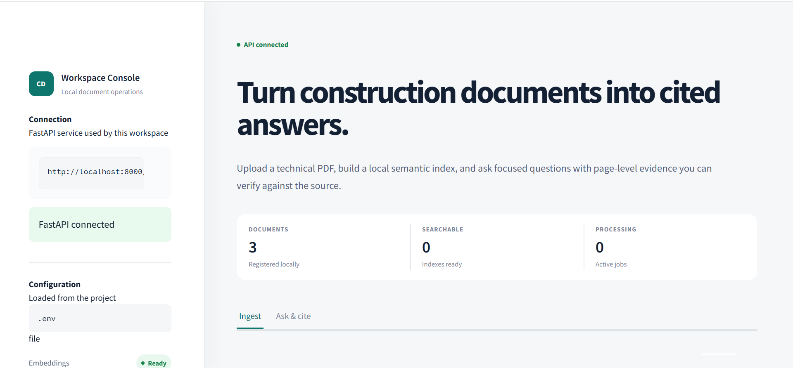

<div align="center">

# 🏗️ BuildCite - Construction Document RAG Platform

A Python + FastAPI + Streamlit Retrieval-Augmented Generation platform for uploading construction PDFs, extracting document text, building per-document FAISS indexes, and answering technical questions with page-level citations.


</div>

---

## 📌 Project Overview

**Construction Document RAG** is a local document-intelligence platform designed to make construction and architectural PDFs searchable through natural-language questions.

The application combines a **FastAPI backend**, **Streamlit workspace**, **SQLite persistence**, **PyMuPDF text extraction**, optional **Google Vision OCR**, **OpenAI embeddings**, **FAISS vector retrieval**, optional **BM25 reranking**, and an **OpenAI or Anthropic answer provider**.

Users can upload a PDF, monitor background ingestion, retry a failed job, ask document-specific questions, and review page-level citations before checking the original source.

---

## ✨ Features

### 📄 Document Workspace

- 📤 **PDF upload and processing** through Streamlit or REST API
- ✅ **Upload validation** for file type, MIME type, PDF signature, readability, encryption, size, and page limits
- 🔄 **Background ingestion states**: `pending → processing → completed/failed`
- ♻️ **Failed-document retry** without uploading the validated source PDF again
- 📋 **Document listing and processing status**
- 🧹 **Derived-artifact cleanup** after ingestion failures
- 💾 **Local SQLite persistence** for document metadata and chat history

### 🧠 RAG and Document Intelligence

- 📖 **Embedded PDF text extraction** with PyMuPDF
- 👁️ **Optional Google Vision OCR** for scanned documents
- ✂️ **Page-aware text chunking**
- 🔢 **OpenAI embeddings** using `text-embedding-3-small` by default
- 🗂️ **Per-document FAISS vector indexes**
- 🎯 **Optional BM25 reranking** for improved retrieval precision
- 🤖 **OpenAI or Anthropic answer generation**
- 🔎 **Optional page-number filtering** during queries
- 📍 **Page-level citations** with retrieved excerpts and similarity scores
- 💬 **Saved and clearable chat history** per document

### 🛡️ Reliability and Safety Controls

- 🔒 **Local-only network binding** by default
- 🔑 **Optional hosted-demo and admin access keys**
- 🚦 **Bounded upload, page, polling, and ingestion-concurrency limits**
- 🧾 **Request IDs and structured error responses**
- 🙈 **Sanitized browser errors** while detailed provider failures remain in server logs
- 🌐 **Explicit CORS and trusted-host configuration**
- 🧪 **Mocked automated tests** that do not spend provider credits

### 🖥️ Streamlit Interface

- 📊 **Workspace overview** with backend and document status
- 📥 **PDF upload panel** with live processing progress
- 🔁 **Retry processing controls** for failed jobs
- 💬 **Document chat interface**
- 🏷️ **Citation chips and citation details**
- 🗃️ **Document and chat-history controls**
- 📱 **Responsive light-mode portfolio interface**
- 👨‍💻 **Developer attribution** for Muhammad Ali Nawaz 2026

---

## 🖼️ Screenshots

```markdown
| Streamlit Homepage |
| --- |
|  |
```

---

## 🧰 Tech Stack

### Frontend

- Streamlit 1.39
- Requests / HTTP client integration
- Custom responsive CSS
- Streamlit forms, tabs, status panels, progress indicators, and chat components

### Backend

- Python 3.12+
- FastAPI 0.115
- Uvicorn
- Pydantic Settings
- SQLAlchemy AsyncIO
- aiosqlite
- AnyIO
- HTTPX
- Tenacity

### RAG and AI

- PyMuPDF
- OpenAI embeddings
- FAISS CPU
- rank-bm25
- OpenAI language models
- Anthropic language models
- Google Cloud Vision OCR (optional)
- pdf2image (optional OCR support)

### Storage and Deployment

- SQLite
- Local filesystem storage
- Docker
- Docker Compose

### Quality Assurance

- pytest
- pytest-asyncio
- Ruff
- mypy
- Python `compileall`

---

## 📁 Folder Structure

```text
construction-doc-rag-platform/
├── .streamlit/
│   └── config.toml
├── docker/
│   ├── Dockerfile
│   └── docker-compose.yml
├── frontend/
│   └── streamlit_app.py
├── rag_pipeline/
│   ├── api/
│   │   ├── routes/
│   │   ├── schemas/
│   │   ├── deps.py
│   │   └── main.py
│   ├── core/
│   ├── db/
│   │   └── repositories/
│   └── services/
│       ├── documents/
│       ├── embeddings/
│       ├── llm/
│       ├── ocr/
│       └── rag/
├── requirements/
│   ├── base.txt
│   └── dev.txt
├── tests/
│   ├── conftest.py
│   ├── test_chunking.py
│   ├── test_document_workflow.py
│   └── test_faiss_store.py
├── .dockerignore
├── .env.example
├── .gitignore
├── LICENSE
├── pyproject.toml
├── requirements.txt
└── README.md
```

The application creates `data/` locally for the SQLite database, uploaded PDFs, extracted text, structured output, and FAISS indexes. This directory is excluded from Git.

---

## 🔐 Environment Variables

Never commit a real `.env` file or publish API keys. Copy `.env.example` to `.env` and keep placeholders in documentation.

### Recommended Local OpenAI Configuration

```env
APP_MODE=local
LOG_LEVEL=INFO

HOST=127.0.0.1
PORT=8000
CORS_ORIGINS=http://localhost:8501,http://127.0.0.1:8501
ALLOWED_HOSTS=localhost,127.0.0.1,testserver,api
API_BASE_URL=http://127.0.0.1:8000/v1

STORAGE_DIR=./data
DATABASE_URL=sqlite+aiosqlite:///./data/app.db

MAX_UPLOAD_BYTES=26214400
UPLOAD_CHUNK_BYTES=1048576
MAX_PDF_PAGES=500
MAX_CONCURRENT_INGESTIONS=2
MAX_POLL_SECONDS=180

OCR_MODE=text_only
GOOGLE_APPLICATION_CREDENTIALS=

EMBEDDING_MODEL=text-embedding-3-small
RERANK_MODE=bm25
TOP_K_DEFAULT=6
RERANK_TOP_N=20

LLM_PROVIDER=openai
LLM_MODEL=gpt-5.6-sol
OPENAI_API_KEY=replace_with_your_openai_api_key
ANTHROPIC_API_KEY=

DEMO_ACCESS_KEY=
ADMIN_API_KEY=
```

`gpt-5.6-sol` is the exact GPT-5.6 Sol API model identifier. Model access and API usage depend on the OpenAI API account and billing configuration.

### Optional Anthropic Configuration

```env
LLM_PROVIDER=anthropic
LLM_MODEL=replace_with_an_available_anthropic_model
ANTHROPIC_API_KEY=replace_with_your_anthropic_api_key
OPENAI_API_KEY=replace_with_your_openai_api_key
```

`OPENAI_API_KEY` remains required because document and question embeddings use OpenAI even when Anthropic generates the final answer.

### OCR Modes

| Value | Behavior | Additional requirement |
| --- | --- | --- |
| `text_only` | Extract embedded PDF text only | None |
| `auto` | Use embedded text first and OCR when configured | Google credentials for OCR fallback |
| `google_vision` | OCR every page | `GOOGLE_APPLICATION_CREDENTIALS` |

---

## 🚀 Getting Started on Windows

### Prerequisites

Install:

- Windows 10 or Windows 11
- Python 3.13 x64 — the project supports Python 3.12+
- A valid OpenAI API key for embeddings
- A valid OpenAI or Anthropic model/key combination for answers
- Docker Desktop only if you want the container workflow
- Poppler only if using Google Vision OCR through `pdf2image`

Ubuntu, WSL, Anaconda, and Miniconda are not required for the standard Windows setup.

---

## ▶️ Run the Complete Project

Use **Windows Command Prompt (CMD)** and run commands from the project root.

### 1. Create a Clean Virtual Environment

```bat
cd /d "D:\Resumes\Projects\Python\Projects\construction-doc-rag-platform"

if exist ".venv" rmdir /s /q ".venv"
python --version
python -m venv .venv
call .venv\Scripts\activate.bat

where python
python --version
```

After activation, `where python` should list `.venv\Scripts\python.exe` first.

### 2. Install Project and Development Dependencies

```bat
python -m pip install --upgrade pip
python -m pip install -r requirements.txt
python -m pip install -r requirements\dev.txt
python -m pip install -e .
python -m pip check
```

The SQLAlchemy dependency should include its AsyncIO extra:

```text
SQLAlchemy[asyncio]==2.0.36
```

### 3. Create and Configure `.env`

```bat
copy .env.example .env
notepad .env
```

Add your real provider credentials locally, save the file, and restart running services whenever `.env` changes.

Verify configuration without printing the secret:

```bat
python -c "from dotenv import load_dotenv; import os; load_dotenv(); k=os.getenv('OPENAI_API_KEY',''); m=os.getenv('LLM_MODEL',''); print('OPENAI_API_KEY configured:', bool(k) and not k.startswith('replace_') and not k.startswith('your_')); print('LLM_PROVIDER:', os.getenv('LLM_PROVIDER')); print('LLM_MODEL configured:', bool(m) and not m.startswith('replace_') and not m.startswith('your_'))"
```

### 4. Start the FastAPI Backend

Open the first CMD window:

```bat
cd /d "D:\Resumes\Projects\Python\Projects\construction-doc-rag-platform"
call .venv\Scripts\activate.bat
python -m uvicorn rag_pipeline.api.main:app --host 127.0.0.1 --port 8000 --reload
```

Backend URLs:

```text
Health:  http://127.0.0.1:8000/v1/admin/health
Swagger: http://127.0.0.1:8000/docs
OpenAPI: http://127.0.0.1:8000/openapi.json
```

### 5. Start the Streamlit Frontend

Open a second CMD window:

```bat
cd /d "D:\Resumes\Projects\Python\Projects\construction-doc-rag-platform"
call .venv\Scripts\activate.bat
python -m streamlit run frontend\streamlit_app.py --server.address 127.0.0.1 --server.port 8501
```

Open:

```text
http://127.0.0.1:8501
```

### 6. Stop the Services

Press `Ctrl+C` once in each CMD window.

---

## 🧪 Test the Project

Automated tests mock external OCR, embedding, retrieval, and LLM behavior, so they do not require live provider calls or consume API credits.

### Complete Quality Check

```bat
cd /d "D:\Resumes\Projects\Python\Projects\construction-doc-rag-platform"
call .venv\Scripts\activate.bat

python -m pip check
python -m compileall -q rag_pipeline frontend tests
python -m ruff check rag_pipeline frontend tests
python -m pytest -q
```

Verified result:

```text
16 passed
All checks passed
```

FAISS/SWIG deprecation warnings from third-party packages may appear on Python 3.13. They do not indicate failed project tests.

### Dependency Import Smoke Test

```bat
python -c "import fastapi, sqlalchemy, fitz, faiss, streamlit; print('All project dependencies imported successfully')"
```

### Create a Synthetic Test PDF

```bat
python -c "import fitz; d=fitz.open(); p=d.new_page(); p.insert_text((72,72),'Synthetic Karachi community centre project. Structural package cost: PKR 2,500,000. Steel beams are specified on page 1.'); d.save('sample-karachi-project.pdf'); d.close(); print('Created sample-karachi-project.pdf')"
```

Upload `sample-karachi-project.pdf` through Streamlit and wait until its state becomes `completed`.

Ask:

```text
What is the structural package cost?
```

Expected result:

```text
Approximately PKR 2,500,000, supported by a page 1 citation.
```

The exact wording may vary by model. Always verify the cited source excerpt.

---

## 📜 Available Commands

| Command | Description |
| --- | --- |
| `python -m uvicorn rag_pipeline.api.main:app --host 127.0.0.1 --port 8000 --reload` | Start the development API |
| `python -m streamlit run frontend\streamlit_app.py --server.address 127.0.0.1 --server.port 8501` | Start the Streamlit interface |
| `python -m pytest -q` | Run automated tests |
| `python -m ruff check rag_pipeline frontend tests` | Run lint checks |
| `python -m compileall -q rag_pipeline frontend tests` | Compile-check Python source files |
| `python -m pip check` | Check dependency consistency |
| `python -m pip install -e .` | Install the project in editable mode |
| `docker compose -f docker\docker-compose.yml up --build` | Build and start both services with Docker |
| `docker compose -f docker\docker-compose.yml down` | Stop Docker services |

---

## 🔌 Main API Endpoints

| Method | Endpoint | Purpose |
| --- | --- | --- |
| `GET` | `/v1` | API root status |
| `GET` | `/v1/admin/health` | Public health check |
| `GET` | `/v1/documents` | List documents |
| `POST` | `/v1/documents` | Upload and queue a PDF |
| `GET` | `/v1/documents/{document_id}/status` | Read ingestion status |
| `POST` | `/v1/documents/{document_id}/reprocess` | Retry failed ingestion |
| `POST` | `/v1/documents/{document_id}/query` | Ask a document question |
| `GET` | `/v1/documents/{document_id}/chat/history` | Read document chat history |
| `DELETE` | `/v1/documents/{document_id}/chat/history` | Clear document chat history |
| `GET` | `/v1/admin/stats/documents` | Read document statistics |
| `GET` | `/v1/admin/stats/storage` | Read storage statistics |
| `POST` | `/v1/admin/reset` | Reset local application data with admin key |

Use the interactive Swagger interface at `http://127.0.0.1:8000/docs` to inspect request and response schemas.

---

## 🎯 Project Flow

```text
User uploads a validated construction PDF
└── FastAPI stores the source and queues ingestion
    ├── Extract embedded text or use configured OCR
    ├── Split page-aware content into chunks
    ├── Generate OpenAI embeddings
    ├── Persist a per-document FAISS index
    └── Mark the document completed or safely failed
        └── User selects the completed document
            ├── Question is embedded
            ├── FAISS retrieves relevant chunks
            ├── BM25 optionally reranks results
            ├── Configured LLM generates a grounded answer
            └── Streamlit displays the answer and page citations
```

---

## 🧠 Retrieval-Augmented Generation Flow

```text
Construction PDF
└── Text Extraction / Optional OCR
    └── Page-Aware Chunking
        └── OpenAI Embeddings
            └── FAISS Vector Index
                └── Similarity Retrieval
                    └── Optional BM25 Reranking
                        └── OpenAI or Anthropic Answer
                            └── Page-Level Citations
```

---

## 🐳 Docker

Docker is optional. The standard Windows virtual-environment workflow does not require Ubuntu or WSL.

Create `.env`, then run:

```bat
docker compose -f docker\docker-compose.yml up --build
```

Open:

```text
FastAPI:   http://127.0.0.1:8000/docs
Streamlit: http://127.0.0.1:8501
```

Stop containers:

```bat
docker compose -f docker\docker-compose.yml down
```

---

## ⚠️ Scope and Limitations

- Background ingestion runs inside the API process; restarting the server can interrupt active work.
- SQLite and automatic schema creation are suitable for this local prototype, not a distributed production deployment.
- The project does not provide user accounts, tenant isolation, a distributed job queue, automatic retention, or database migrations.
- Uploaded PDFs and derived indexes remain on local disk until manually removed or reset.
- Configured providers may receive document text and may charge for embeddings, OCR, or generated answers.
- RAG answers can be incomplete or incorrect; users should verify citations against the original PDF.
- Use synthetic or non-confidential files for portfolio demonstrations.

---

## 🧑‍💻 Author

**Muhammad Ali Nawaz**  
Python Developer / AI Developer  

---

## 📄 License

This project is licensed under the [MIT License](LICENSE).

---

<p align="center">
  <b>⭐ If this project helps you, consider starring the repository!</b>
</p>
